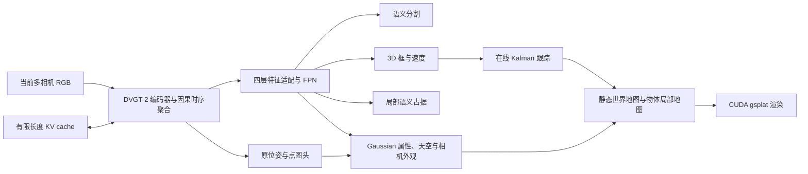

# DVGT-F4：在线多相机感知与动态 Gaussian baseline

本 fork 在 **DVGT-2 官方预训练几何主干**上增加 Foundation4D 风格的语义分割、3D 检测、语义占据、在线目标跟踪和动态 Gaussian 地图。逐帧返回结果，并限制历史缓存与地图大小。它是新的研究 baseline；新增任务头需要训练，不能把官方 DVGT-2 权重直接当作这些任务的预训练权重。

原 DVGT 文档保留在 [README.md](README.md)。本实现入口为 [`stream4d/model.py`](stream4d/model.py)，配置位于 [`configs/stream4d`](configs/stream4d)。实际验证记录见 [`reproduction_status.json`](reproduction_status.json)，已测试依赖版本见 [`requirements-f4-tested.txt`](requirements-f4-tested.txt)。

## 架构与来源



| 模块 | 实现与参考 | 与原论文的差异 |
|---|---|---|
| 主干/几何 | 直接实例化 fork 中的 DVGT-2；官方 checkpoint 严格加载；DINOv3、24 层聚合、原点图与位姿头保留 | 新增可选编码器注入参数，保持所有 state_dict 名称和尺寸 |
| 流式状态 | `backends.py`：逐帧 KV cache、位姿 token、连续时间位置；缓存裁剪会复制释放旧存储 | 包装成持续 `step()`；保护上游位姿头的原地加法；每帧独立扩散随机种子 |
| 多任务特征 | 读取第 4/11/17/23 层的 3072 维特征，四尺度 FPN | 未声称复刻 Foundation4D 全部编码器/decoder 结构 |
| 检测/占据 | 3D reference points 投影采样、多层辅助监督；占据包含 binary/semantic/BEV 分支 | 简化的投影 attention；没有 DN-DETR/YOLOX 辅助分支；无历史 BEV 显式缓存 |
| 跟踪 | 恒速 Kalman、类别/距离门控 Hungarian、限时轨迹保留 | 严格前向，未采用 Foundation4D 的全片二次关联与 RTS 后向平滑 |
| Gaussian | 几何深度先验上的独立可训练深度残差，颜色/尺度/旋转/透明度/法线；天空 cubemap；相机 affine | 深度残差不同于论文独立 DPT 初始化；动态运动来自跟踪 |
| 地图 | 静态世界坐标、物体局部坐标；体素去重、数量/空间范围/轨迹寿命上限 | 最新观测替换和透明度筛选；无全局 bundle adjustment、回环或无限全局地图 |
| 渲染/损失 | CUDA gsplat + 小规模 PyTorch 参考后端；留出视角 RGB、range、opacity、sky、appearance；可选 LPIPS/法线 | 并非 Instant NuRec rasterizer；论文全部训练配方及正则项尚未逐项复刻 |

参考：[DVGT-2 论文](https://arxiv.org/abs/2604.00813)、[官方代码](https://github.com/wzzheng/DVGT)、[官方权重](https://huggingface.co/RainyNight/DVGT-2)、[Foundation4D 论文](https://arxiv.org/abs/2610.30340)、[gsplat API](https://docs.gsplat.studio/main/apis/rasterization.html)。依赖提交、权重 revision 和 SHA256 固定在 `upstream.lock.json`。几何和参考 rasterizer 部分参考了同目录下先前的非官方 Foundation4D 实现，现已独立放入此仓库，不依赖其 import。

## 安装与准备

从仓库根目录执行。当前机器已建立 `.venv` 并准备官方权重；新机器可按下列步骤安装。PyTorch/CUDA 版本需要与显卡和编译环境匹配。

```bash
python -m venv --system-site-packages .venv
.venv/bin/python -m pip install -e '.[dvgt2,render]'
.venv/bin/python tools/stream4d/setup.py --weights --verify-checksum
```

`setup.py` 获取锁定的 DINOv3 代码、官方轨迹/位姿锚点以及约 6.84 GB 的 DVGT-2 checkpoint。checkpoint 已包含 DINOv3 参数，无需再申请/下载独立 DINOv3 权重。正常构造模型不会隐式联网下载权重。首次 CUDA splatting 会编译扩展，需要匹配的 CUDA toolkit；没有 CUDA 编译条件时可显式选择 `renderer: reference`，该后端有 `G×H×W <= 32M` 的保护限制。

```bash
# 完整小规模测试、感知/联合训练、逐帧推理与参考渲染
bash tools/stream4d/smoke.sh

# 使用真正的官方权重，验证跨缓存窗口的推理和新头反向传播
.venv/bin/python tools/stream4d/validate_pretrained.py --frames 12 --train-step
# CUDA 与参考 renderer 的像素中心、RGB、径向距离与梯度对照
.venv/bin/python tools/stream4d/validate_render.py
```

`tiny` 只用于集成测试，CLI 拒绝将它当作真实数据 baseline。合成训练的 adapter 也不能作为真实数据结果使用。

## 数据接口

PAI 原始数据小子集的下载、访问授权和划分说明见 [PAI mini](docs/pai_mini.md)。现已提供 [PAI 适配与训练流程](docs/pai_training.md)：六相机 f-theta 去畸变、逐点 LiDAR 自车运动补偿、自动标注框、二值占据及留出帧重建监督。入口为 `tools/data_process/prepare_pai.py`，使用 `configs/stream4d/pai.yaml`；`bash tools/stream4d/pai_smoke.sh` 验证真实数据的训练和在线推理。

输入为 JSONL，每行指向一个时间戳的多相机样本；读取器逐行加载单帧，不将整个视频放入内存。示例：

```json
{"npz":"scene_01/frame_000000.npz","scene_id":"scene_01","timestamp_us":1700000000000000,"camera_ids":["front","left","right"]}
```

NPZ 使用 `allow_pickle=False`。也可在 JSON 行中指定 `image_paths`，并提供与图像分辨率对应的标定。每个 scene 必须连续排列，时间严格递增，相机顺序、数量、标定及分辨率固定。分辨率必须是 16 的倍数（tiny 配置为 8）。输入必须已去畸变、对齐到同一近似同步时刻；默认允许相机与参考时间相差最多 30 ms，不进行异步运动补偿。过大的帧间隔、标定变化或相机重排会要求显式重置状态。

| 字段 | 形状和约定 |
|---|---|
| `images` | `[V,3,H,W]` float `[0,1]` 或 uint8；相机图像为 OpenCV RDF |
| `intrinsics` | `[V,3,3]`，去畸变后且对应当前分辨率的 K |
| `camera_to_ego` | `[V,4,4]`，相机 RDF → 自车 FLU，米 |
| `timestamp_us` / `timestamp` | 整数微秒 / float64 秒；读取器先减场景起始时间，再用于计算 |
| `camera_timestamps_us` | 可选，各相机整数微秒拍摄时间 |
| `depth_z` | 可选 `[V,H,W]`，相机 z-depth 米，0/非有限值忽略 |
| `points_ego` | 可选 `[V,H,W,3]`，自车 FLU 米；无效点填 NaN |
| `semantics` | 可选 `[V,H,W]`，图像语义类别，-1 为未知 |
| `boxes` | 可选 `[N,9]`：`cx,cy,cz,dx,dy,dz,yaw,vx,vy`，当前自车 FLU；速度是物体绝对运动在自车坐标轴上的分量 |
| `box_labels` / `box_ids` | `[N]`，类别从 0 开始；动态重建需稳定 ID |
| `occupancy` | 可选 `[X,Y,Z]`：-1 未知、0 确定自由、1..C 占据类别；网格 bounds/shape 必须匹配配置 |
| `occupancy_binary` | 可选 `[X,Y,Z]`：-1 未知、0 观测自由、1 命中；只训练 binary 分支 |
| `box_velocity_valid` | 可选 `[N]` bool；无法估计绝对速度的框屏蔽速度匹配和回归 |

**Physical AI / Waymo：**PAI 现有本地原始数据适配器，支持当前 mini 的 offline f-theta 与 Draco 格式，并使用明确的 12 类检测映射；Waymo 原始读取器尚未提供。Physical AI 的相机径向 range 需要按单位相机射线转为 z-depth；不能使用自车原点距离替代相机 range。稀疏占据中未列出的体素不能自动标成 free。PAI 去畸变采用中点时刻近似，没有 rolling shutter 逐行补偿或逐相机图像时间重投影。语义标签仍需显式映射并设置 `sky_class`/`dynamic_classes`；`configs/stream4d/dvgt2.yaml` 的默认类别数不代表 PAI 协议。

重建训练额外需要 `world_from_ego`、`target_rgb`、`target_intrinsics`、`target_camera_to_world`，并在 JSON 行声明 `target_is_held_out: true`。目标 RGB 只参与 loss，不进入源图像主干。动态场景还需 `box_ids`、`target_boxes_world`、`target_box_ids`；源/目标标注使用同一个世界坐标系。`target_camera_indices` 指定目标图像对应哪个源相机的外观变换，默认按相同顺序。可选 `target_valid`、`target_range`、`target_non_sky`、`normals_ego`。

## 训练与推理

```bash
# 先冻结官方主干，训练语义、检测和占据分支
bash run_f4.sh train --config configs/stream4d/dvgt2.yaml \
  --manifest data/train.jsonl --stage perception --steps 10000 \
  --output outputs/perception

# 训练 Gaussian 分支；数据需有留出视角/时刻的渲染监督
bash run_f4.sh train --checkpoint outputs/perception/adapter.pt \
  --manifest data/train_render.jsonl --stage gaussian --steps 10000 \
  --output outputs/gaussian

# 联合训练，可按实验选择 LPIPS
bash run_f4.sh train --checkpoint outputs/gaussian/adapter.pt \
  --manifest data/train_render.jsonl --stage joint --steps 10000 \
  --output outputs/joint --lpips

# 每个时刻写一个 NPZ，立即释放当帧预测；stream.jsonl 记录状态预算
bash run_f4.sh infer --checkpoint outputs/joint/adapter.pt \
  --manifest data/val.jsonl --output outputs/val --render --render-size 256 448
```

LPIPS 构造可能下载其感知网络权重；小分辨率 smoke 默认关闭。训练数据必须使用独立的 train split；不要把论文的 PAI 测试集训练后再当作复现评估。当前 CLI 输出深度 MAE 及状态统计，尚未集成官方检测 mAP、tracking HOTA、occupancy mIoU 等 benchmark evaluator。

保存的 adapter 包含新增头和必要的微调参数；官方几何主干仍从锁定 checkpoint 加载。`backend.finetune_last_blocks > 0` 可解冻最后若干时空聚合块，使用逐帧、历史状态 detach 的一步截断反向传播。原位姿扩散头保持冻结；这不是官方整窗训练配方，不能声称实现了原位姿/规划头的联合重训练。需要新配置实验时先在 YAML 设置，然后训练并检查显存。已验证解冻最后 1 个时空块的梯度更新。24 GB 4090 上的低分辨率验证不代表完整分辨率六相机实时性能。

API 示例：

```python
import torch
from stream4d.checkpoint import load_adapter
from stream4d.data import iter_frames, to_device

model, metadata = load_adapter('outputs/joint/adapter.pt', 'cuda')
model.eval()
state = None
with torch.inference_mode():
    for frame in iter_frames('data/one_scene.jsonl'):
        outputs, state = model.step(to_device(frame, 'cuda'), state)
        consume(outputs)  # 下游消费当帧结果；需要历史时逐步写盘
# 新场景：state = None
```

`world_from_ego` 的世界原点是第一帧自车坐标系；相对位姿方向为 previous→current，累计世界位姿使用其逆变换。Gaussians 的四元数为 wxyz。在线跟踪输出包含已观测与短时预测轨迹；动态物体发生 ID 切换时，其地图可能重新建立。状态有界不意味着整段世界地图完整保存：离开活动范围的点会淘汰；需要长期地图档案时应额外导出子地图。

## 当前边界

- 检测、二值占据、Gaussian 和可选几何微调已通过 PAI 真实数据短训练；这不是收敛权重。图像语义、语义占据和 BEV 语义分类器仍缺监督，checkpoint 用 `trained_tasks` 标记实际训练任务。
- 支持丰富的输出类型；不等同于 Foundation4D 论文架构、数据规模或评估成绩的完整复现。
- 没有全局 PGO/回环、离线轨迹平滑、模型内部的畸变相机投影和正式数据集 evaluator；PAI 在预处理时转换为 pinhole。
- 严格在线跟踪与有界局部地图是本 baseline 的设计选择，需要独立评估精度、延迟与地图完整性。

